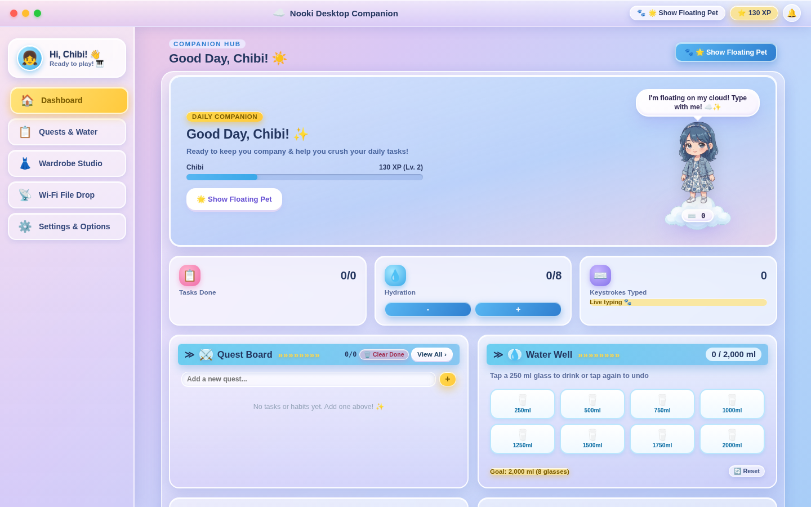
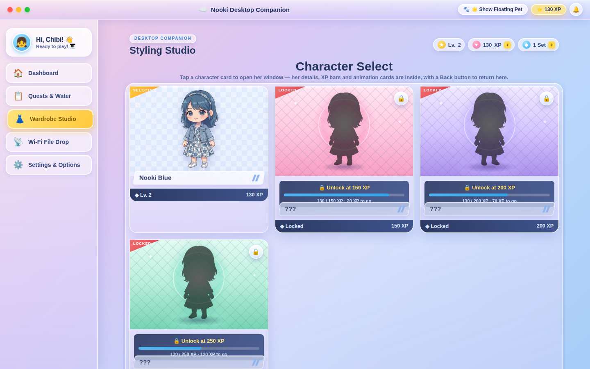
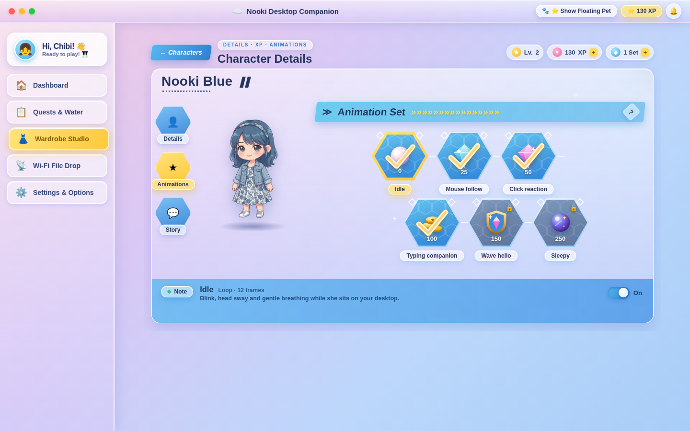
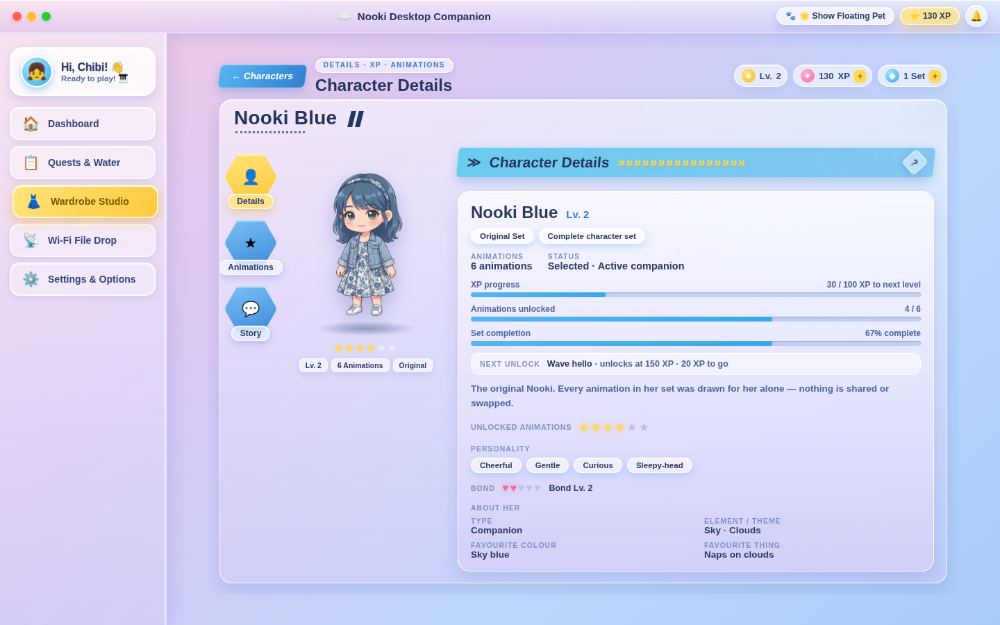
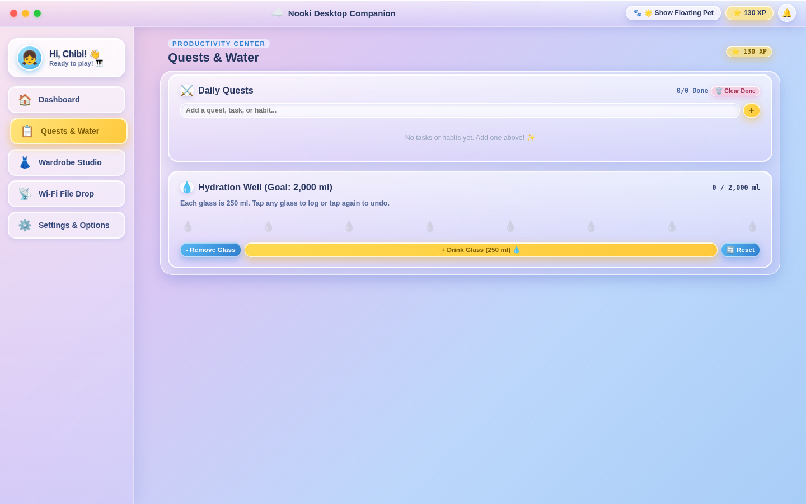
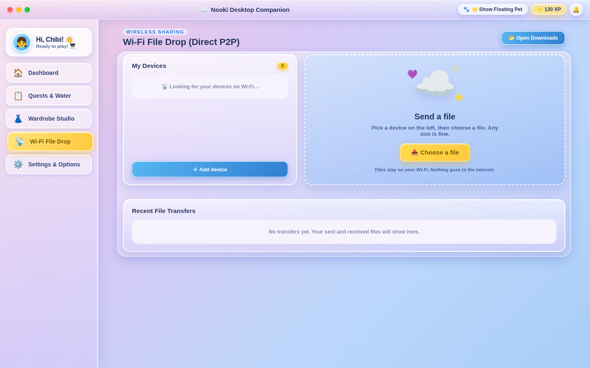

# Nooki — Desktop Companion

A blue-haired chibi companion who lives on your desktop — she keeps you company while you work, tracks your quests and water, and levels up with you.



## What it is

Nooki is a small desktop companion app for macOS and Windows. She floats on your screen as a transparent pet — blinking, swaying, breathing, and following your cursor with her eyes — while a companion dashboard helps you look after your day:

- **Floating pet** — a transparent always-on-top chibi who follows your mouse with her eyes, giggles when clicked, and can be resized from her corner handle.
- **Quests & water** — a daily Quest Board and Water Well. Finish quests for XP, log glasses of water, and watch Nooki level up with you.
- **XP & levels** — everything you do earns XP: +15 per quest, +5 per glass of water, +30 bonus when you hit your daily water goal. Level = every 100 XP.
- **Styling Studio** — a character studio with Nooki Blue and her six-animation set. Animations unlock with XP (0 / 25 / 50 / 100 / 150 / 250), and three mystery characters are waiting to be unlocked at 150 / 200 / 250 XP.
- **Wi-Fi File Drop** — send files directly between your computer and your phone, tablet, or another computer on the same Wi-Fi. Nothing goes to the internet.
- **Gentle reminders** — quest reminders at the times you set, water reminders, quiet hours, and eye-rest nudges, all delivered by Nooki herself.

Everything is stored locally on your computer. No account, no cloud, no tracking.

## Screenshots

| Dashboard | Styling Studio — Character Select |
| --- | --- |
|  |  |

| Studio — Animations | Studio — Details |
| --- | --- |
|  |  |

| Quests & Water | Wi-Fi File Drop |
| --- | --- |
|  |  |

More screenshots and a full walkthrough are in the [User Guide](docs/GUIDE.md).

## Downloads & install

Get the latest build from the [Releases page](https://github.com/yumeokoete-dev/chibi-ai-widget/releases).

**macOS** — download the `.zip`, unzip it, and move `NookiDesktop.app` where you like (for example, Applications). The app is unsigned, so the first time you open it, **right-click the app → Open** and confirm. After that it opens normally.

**Windows** — download the `.zip`, unzip it, and run `NookiDesktop.exe`. The app is unsigned, so SmartScreen may appear: click **More info → Run anyway**.

## Run from source

You need [Node.js](https://nodejs.org/) installed.

```bash
npm install     # install dependencies (Electron)
npm start       # launch the desktop app (Electron)
npm run serve   # browser preview instead — serves the UI via server.js
```

## Build

Packaging uses [electron-packager](https://github.com/electron/electron-packager). If it isn't installed yet, add it once with `npm install --save-dev @electron/packager`:

```bash
npm run pack:mac   # macOS (Apple Silicon, arm64) → dist/
npm run pack:win   # Windows (x64) → dist/
```

## Project structure

| File | What it does |
| --- | --- |
| `main.js` | Electron main process — creates the dashboard window and the transparent floating-pet window. |
| `preload.js` | Small bridge between the Electron main process and the UI. |
| `index.html` | The whole UI: Dashboard, Quests & Water, Styling Studio, Wi-Fi File Drop, Settings. |
| `script.js` | Core app logic — state, XP/levels, quests, water, the floating pet's behaviour. |
| `server.js` | Local server for Wi-Fi File Drop (device discovery and peer-to-peer transfer on your network). |
| `style.css` | Base styling for the app. |
| `nooki-studio.js` / `nooki-studio-theme.css` | The Styling Studio: Character Select, Details / Animations / Story, unlocks by XP. |
| `nooki-dash-studio.js` | The Studio summary card on the Dashboard (level, animations unlocked, next unlock). |
| `nooki-settings.js` / `nooki-settings-theme.css` | The tabbed Settings screen (five tabs over the settings cards). |
| `nooki-app-theme.css` | The shared whole-app theme (glass sheets, title bars, card styling). |
| `nooki-single-character.js` / `.css` | Nooki's layered character rig (body → eyes → head) and her animations. |
| `nooki-reminders.js` / `.css` | Gentle reminders: quests, water, quiet hours, eye rest. |
| `nooki-drop.js` / `nooki-drop-page.css` | Wi-Fi File Drop UI logic and styling. |
| `nooki-pet-touch.js` | Click/touch reactions for the floating pet. |
| `nooki-layout.css` | Layout helpers for the app shell. |
| `assets/` | Character art (the `muse_girl_*` rig in `assets/base-rig/`) and other images. |

## Mobile

A separate mobile version of Nooki exists for Android, built from a sibling project. It is developed and released separately from this repository.

## License

MIT — see `package.json`.

Made by **Sachie** ([yumeokoete](https://github.com/yumeokoete-dev)).
