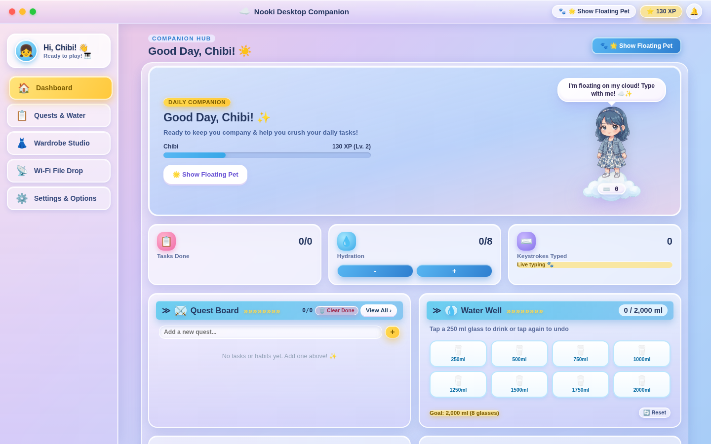
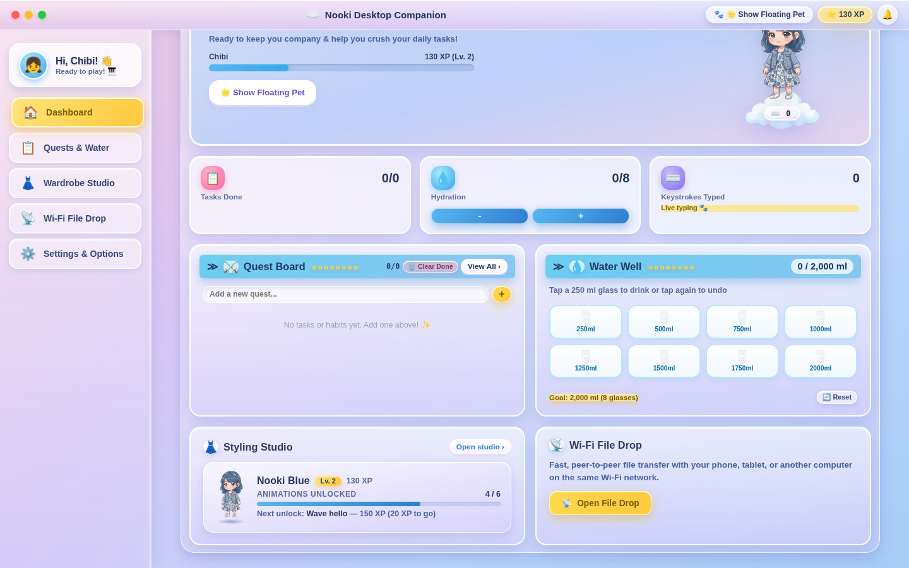
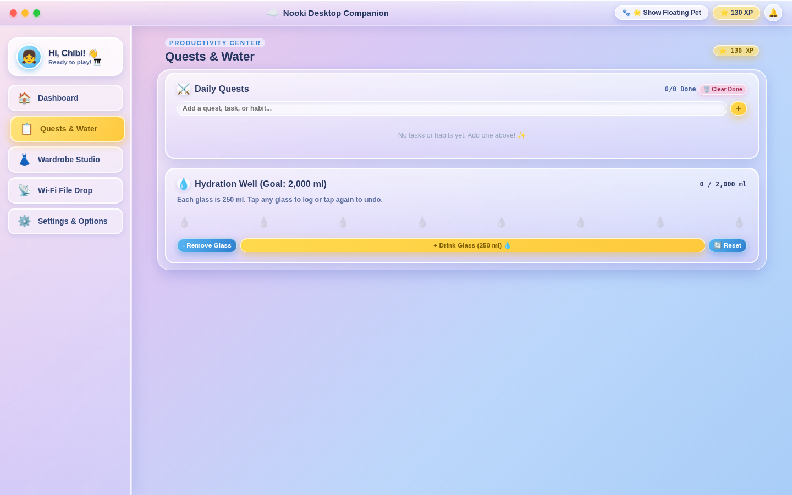
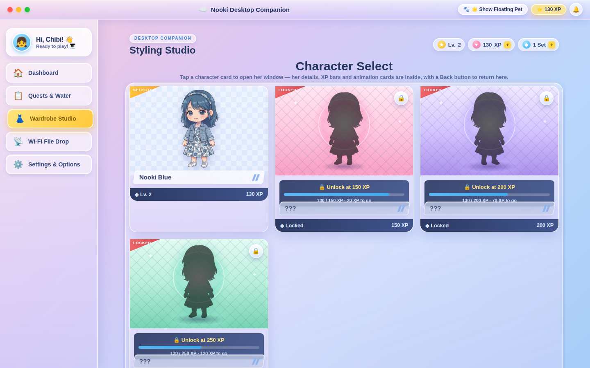
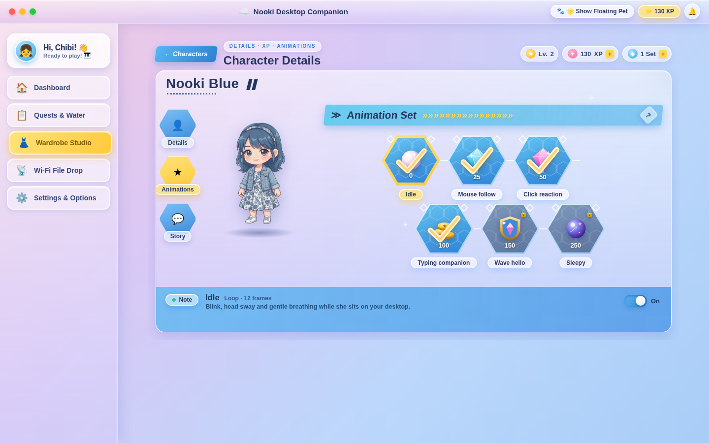
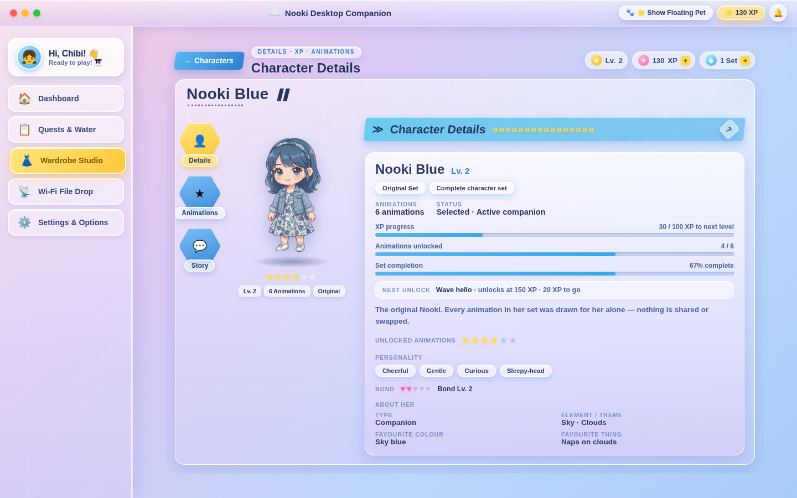
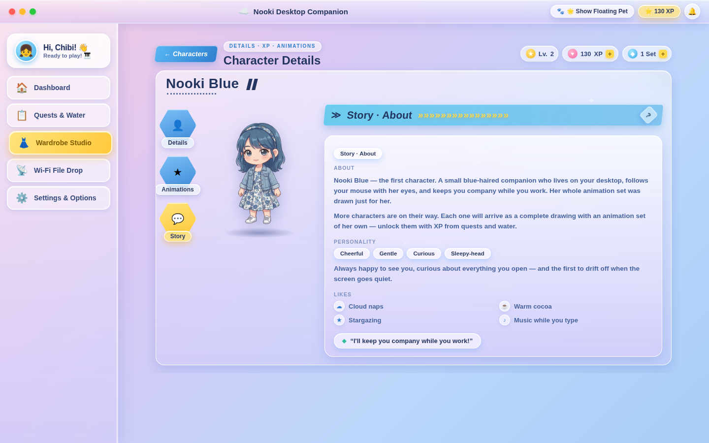
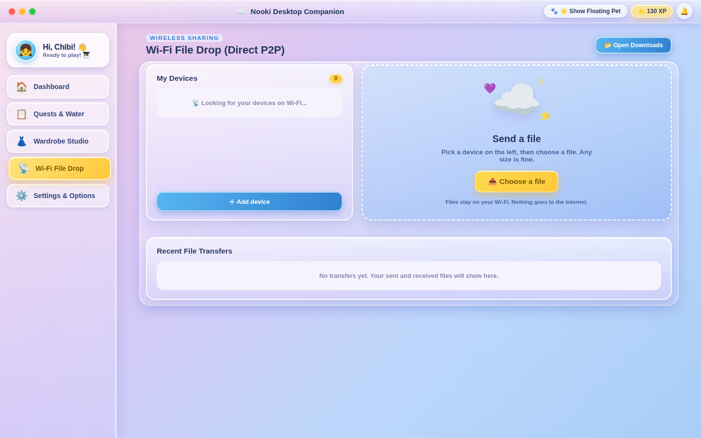
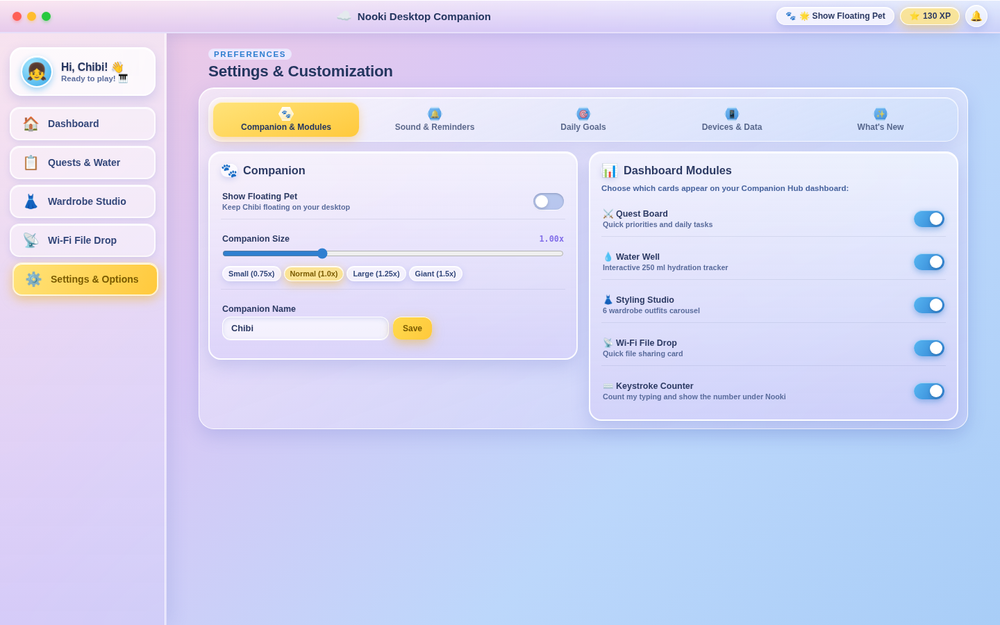

# Nooki — User Guide

The full guide to your desktop companion: what everything does, how XP and unlocks work, and how to fix the small things that can go wrong.

---

## Getting started

### Install

Download the latest build from the [Releases page](https://github.com/yumeokoete-dev/chibi-ai-widget/releases).

- **macOS** — unzip the download and move `NookiDesktop.app` where you like. The app is unsigned, so on the **first open only**: right-click the app → **Open** → confirm. After that it opens like any other app.
- **Windows** — unzip the download and run `NookiDesktop.exe`. If SmartScreen appears, click **More info → Run anyway** (the app is unsigned; this is expected).

### The two windows

Nooki lives in two places at once:

1. **The dashboard window** (the "Companion Hub") — your home base for quests, water, the Styling Studio, File Drop and Settings.
2. **The floating pet** — a small transparent Nooki who floats over your desktop and other apps. She blinks, sways and breathes, follows your cursor with her eyes, and reacts when you click her. Drag her to move her, and drag her corner handle to make her bigger or smaller.

You can hide or bring back the pet at any time with the **Show / Hide Floating Pet** button at the top of the dashboard, or in **Settings → Companion & Modules**.

---

## Dashboard

The Dashboard is the Companion Hub — everything about your day at a glance.

- **Hero card** — Nooki greets you, shows your name, your **XP bar and level** (level goes up every 100 XP), and the Show/Hide Floating Pet button.
- **Stat cards** — **Tasks Done** today, **Hydration** (glasses out of your daily goal), and **Keystrokes Typed** (the desktop keystroke counter — it counts your typing and shows the number under Nooki on her cloud).
- **Quest Board** — a quick view of your daily quests. Add a quest, tick it done, **Clear Done**, or **View All** to jump to the full Quests & Water screen.
- **Water Well** — tap a 250 ml glass to log it; tap the same glass again to undo. The card shows your progress toward the daily goal (2,000 ml = 8 glasses by default).
- **Styling Studio card** — a summary of your Studio progress: Nooki's level and XP, how many animations you have unlocked, and what unlocks next. **Open studio ›** takes you straight there.

Which cards appear on the Dashboard is up to you — see **Settings → Companion & Modules → Dashboard Modules**.

---

## Quests & Water

### Daily Quests

- Type a quest, task or habit and press **+** to add it.
- Tick a quest done to earn **+15 XP**. Unticking it takes the XP back, so the count always matches what you actually finished.
- **Clear Done** removes finished quests from the list.
- Give a quest a **time** (the bell on the quest) if you want Nooki to remind you about it — see [Reminders](#reminders).

### Hydration Well

- Each glass is **250 ml**. Tap a glass (or **+ Drink Glass**) to log it; tap again, or use **− Remove Glass**, to undo.
- Every glass earns **+5 XP**, and reaching your daily goal earns a **+30 XP bonus**.
- Undoing a glass takes its XP back, including the bonus if you drop below the goal.
- Your glass count starts fresh on a new day — but **XP you earned is kept**.
- You can change the daily goal and the glass size in **Settings → Daily Goals**.

---

## Styling Studio

The Studio is where Nooki's characters and animations live. Open it from the sidebar (**Wardrobe Studio**) or from the Dashboard's Studio card.

### Character Select

- **Nooki Blue** is your companion — the card shows her level and XP.
- Three **mystery characters** (the silhouettes marked **???**) are waiting in the same row. Each one unlocks when you reach its XP: **150 XP**, **200 XP** and **250 XP**. Their cards show your progress and how much XP is left to go. Tapping a locked card just gives it a little shake — keep earning!
- Future characters will each arrive as a complete drawing with an animation set of their own.
- Tap Nooki's card to open her window.

### Her window: Details · Animations · Story

Inside a character's window, the hexagon buttons on the left switch between three tabs. The window opens on **Animations**.

#### Animations

Nooki's set has six animations, shown as hexagon tiles. Each tile shows its unlock cost at the bottom:

| Animation | Unlocks at |
| --- | --- |
| Idle | 0 XP |
| Mouse follow | 25 XP |
| Click reaction | 50 XP |
| Typing companion | 100 XP |
| Wave hello | 150 XP |
| Sleepy | 250 XP |

- Unlocked animations show a big tick; locked ones are dimmed with a lock.
- Tap an unlocked animation to select it. The strip at the bottom shows its note (for example, *Idle — Loop · 12 frames — "Blink, head sway and gentle breathing while she sits on your desktop"*) and a **switch to turn that animation on or off**.
- Your on/off choices are remembered.

#### Details

The Details tab is Nooki's character card:

- Her **XP progress** to the next level, **animations unlocked** (for example 4 / 6), and **set completion** percentage.
- **Next unlock** — which animation is coming next and how much XP is left to go.
- Her unlocked-animation stars, **personality** (Cheerful · Gentle · Curious · Sleepy-head), her **Bond** hearts (they grow with her level), and an **About her** grid — type, element/theme, favourite colour and favourite thing.

#### Story

The Story tab tells you about the character: her **About** story, her **Personality**, the things she **Likes** (cloud naps, warm cocoa, stargazing, music while you type), and her quote — *"I'll keep you company while you work!"*

Use **← Characters** at the top to go back to Character Select.

---

## Reminders

Nooki's reminders are gentle and always come from Nooki herself — a sound, a silent bubble, or just her speech bubble, depending on your settings. Every reminder has **Snooze** and **Done**, and only one shows at a time.

- **Quest reminders** — a quest only reminds you if you gave it a time (the bell on the quest).
- **Water reminders** — if no glass has been logged for the interval you chose (every 30 minutes to every 2 hours), Nooki nudges you. Reminders stop for the day once you reach your water goal.
- **Quiet hours** — nothing fires during quiet hours (22:00–08:00 by default). Set your own in **Settings → Sound & Reminders**.
- **Screen time** — after about 20 minutes of active use Nooki suggests an eye rest, and after a longer stretch (50 minutes by default) she nudges you to take a break. Confirming the pause earns a small XP thank-you, once per reminder.
- A **master switch** in the reminder settings turns everything off at once.

Reminder style, snooze length and intervals all live in **Settings → Sound & Reminders**.

---

## Wi-Fi File Drop

File Drop moves files directly between this computer and your phone, tablet, or another computer — **on the same Wi-Fi network**. Files never go to the internet.

1. Open **Wi-Fi File Drop**. Your devices on the network appear under **My Devices** (or use **+ Add device**).
2. Pick a device on the left, then **Choose a file** — any size is fine.
3. When someone sends *you* a file, Nooki shows an **Incoming File** prompt — **Download & Save** or **Decline**.
4. Sent and received files appear under **Recent File Transfers**.

Devices you pair are remembered as **Trusted Devices** (see **Settings → Devices & Data**) so reconnecting is quick.

*Note:* File Drop is powered by the app's built-in local server (it starts on port 3000 and moves to a nearby free port if that one is busy). If a device can't see this computer, check that both are on the same Wi-Fi and that your firewall allows the app on your local network.

---

## Settings

Settings is organised into five tabs in the glass bar at the top:

| Tab | What's inside |
| --- | --- |
| **Companion & Modules** | The **Companion** card (Show Floating Pet, Companion Size, Companion Name) and **Dashboard Modules** — switches for which cards appear on the Dashboard: Quest Board, Water Well, Styling Studio, Wi-Fi File Drop and the **Keystroke Counter**. |
| **Sound & Reminders** | Sound FX and volume, the water-reminder interval, quiet hours, and the reminder options. |
| **Daily Goals** | Your daily water goal and glass size. |
| **Devices & Data** | **Trusted Devices** (devices remembered from Wi-Fi Drop) and **App & Data** — Open at Start-up, Always on Top, Theme Colours, and Backup / Restore / Reset your data. |
| **What's New** | What's New in the Styling Studio — what changed from the old Studio and what replaced it. |

---

## Data & privacy

- **Everything stays on your computer.** Your quests, water, XP, settings and Studio choices are stored locally in the app's own storage on this machine.
- **No account, no cloud, no tracking.** Nooki never sends your data anywhere. The only network feature is Wi-Fi File Drop, which talks directly to your own devices on your own Wi-Fi.
- **Back up or wipe** your data any time in **Settings → Devices & Data → App & Data** (Backup, Restore, or Reset all data).

---

## Troubleshooting

**macOS says the app is from an unidentified developer / won't open.**
The app is unsigned. Right-click the app → **Open** → confirm once. After that it opens normally. (Dragging it straight into a double-click the very first time is what triggers the block.)

**Windows SmartScreen blocks the app.**
Click **More info → Run anyway**. This is the standard prompt for unsigned apps.

**I can't see the floating pet.**
Click **Show Floating Pet** at the top of the dashboard, or turn on **Settings → Companion & Modules → Show Floating Pet**. She may also be hiding behind another window or shrunk very small — check the Companion Size slider in the same place.

**File Drop can't find my phone / computer.**
Both devices must be on the **same Wi-Fi network**, and the Nooki app must be running on both ends. If it still can't connect, your firewall may be blocking the app's local server — allow Nooki through the firewall for private/local networks. The server starts on port 3000 and automatically moves to a nearby free port if 3000 is taken.

**My water count reset but my XP stayed.**
That's by design: glasses reset on a new day, XP and levels are permanent.

**A locked animation or character won't open.**
It hasn't unlocked yet — the tile or card shows the XP it needs. Earn XP from quests (+15) and water (+5 per glass, +30 at the goal) and it will open on its own.

---

## FAQ

**Does Nooki need the internet?**
No. Everything works offline. Wi-Fi File Drop uses your local Wi-Fi only, device to device.

**How do levels work?**
Every 100 XP is a level: level = ⌊XP ÷ 100⌋ + 1. At 130 XP you are level 2 with 30 XP toward level 3.

**Where is my data stored?**
Locally, in the app's storage on your own computer. Uninstalling the app removes it; use Backup in Settings first if you want to keep it.

**Can I turn off the keystroke counter?**
Yes — **Settings → Companion & Modules → Dashboard Modules → Keystroke Counter**. (The counter is a desktop-only feature.)

**Can I change Nooki's name?**
Yes — **Settings → Companion & Modules → Companion Name**.

**How do I start over completely?**
**Settings → Devices & Data → App & Data → Reset all data.** This cannot be undone, so back up first if you might change your mind.
